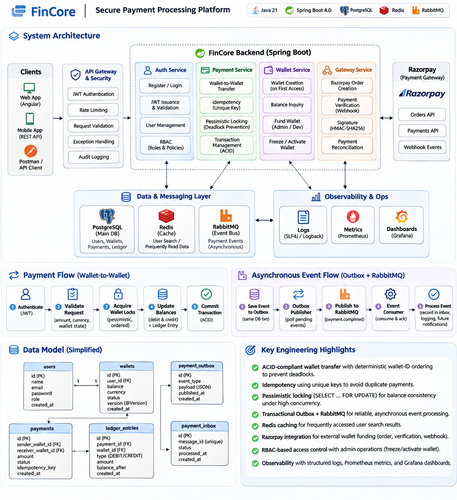
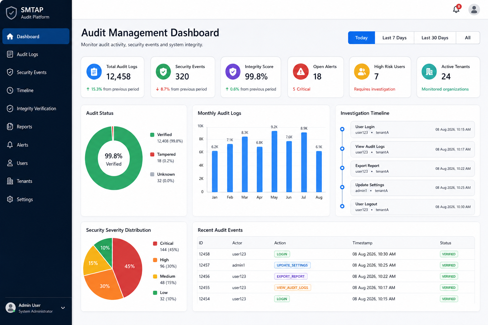
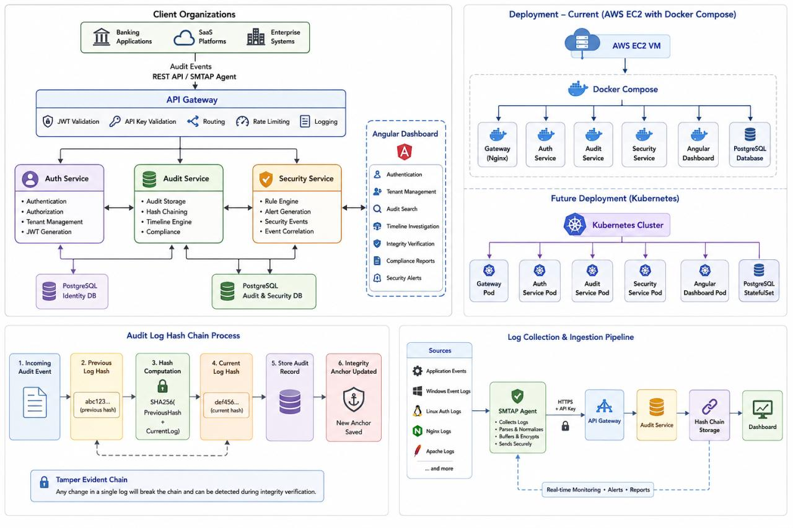
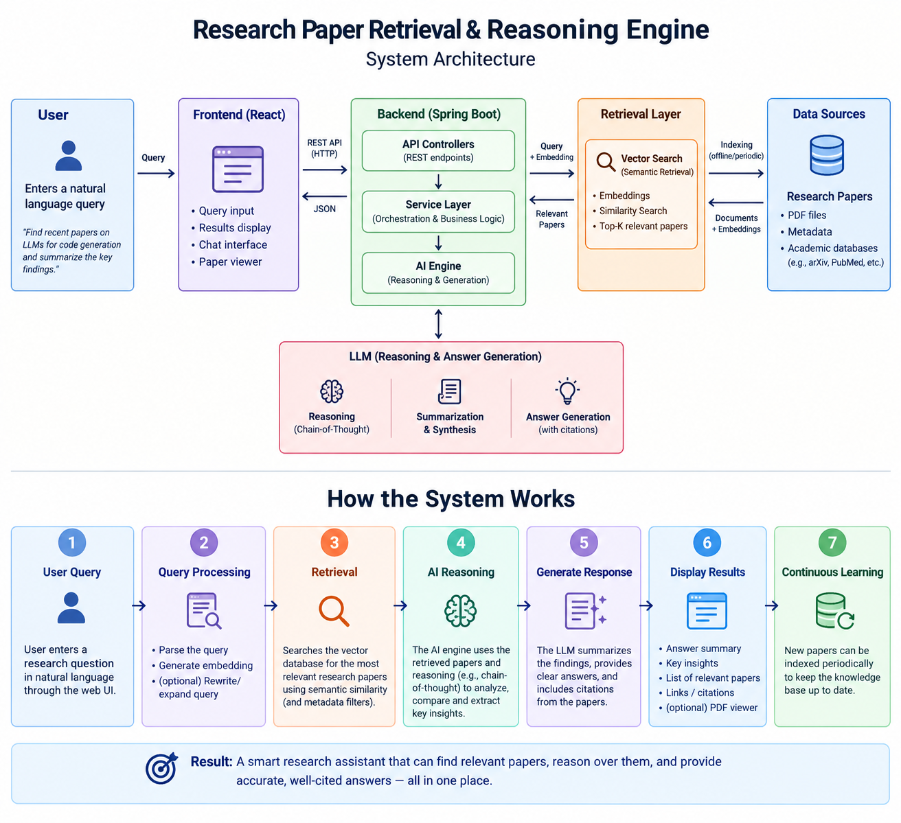
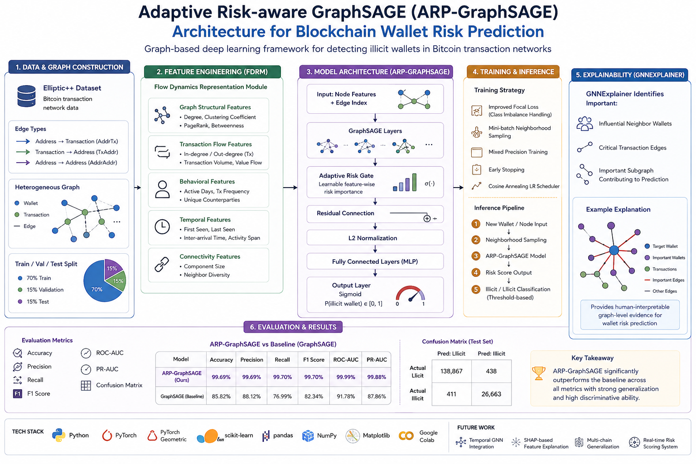
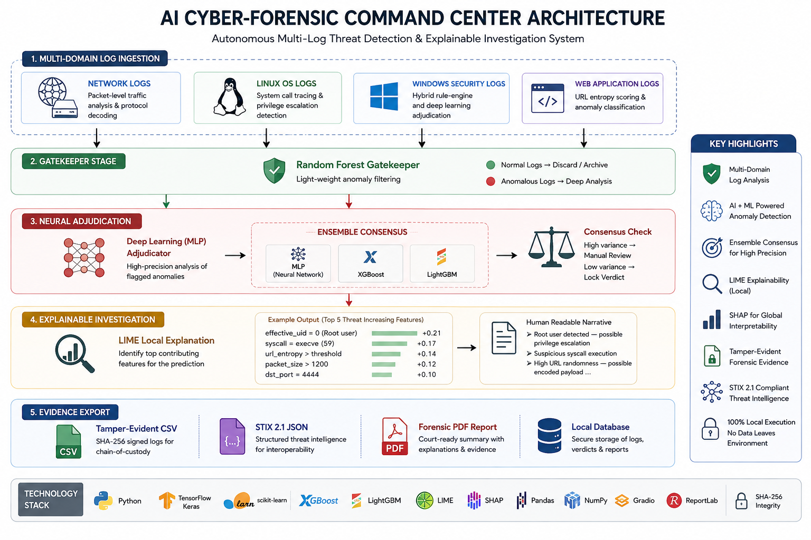
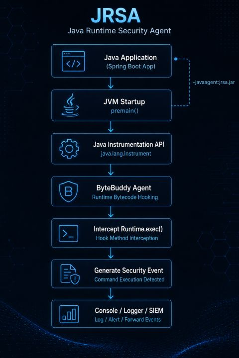

# 👋 Ravi Sankar Manem

**Backend Engineer · Security & Applied AI**

Final-year B.Tech CSE student at RGUKT Nuzvid (graduating May 2027, CGPA 8.53). I build backend systems where **correctness, auditability and observability** are part of the architecture: payment processing, tamper-evident audit infrastructure, JVM runtime security, and retrieval-augmented AI systems.

Currently focused on backend engineering, distributed systems, database concurrency, JVM internals, and security-oriented software. Interested in building reliable systems that remain correct under concurrency, failure, and scale.

📫 [LinkedIn](https://linkedin.com/in/ravi-sankar) · [LeetCode](https://leetcode.com/u/ravimnm28/) · `manemravisankar28@gmail.com`

---

## 🌍 Open Source — NASA Planetary Data System

Merged contributions to [NASA-PDS/validate](https://github.com/NASA-PDS/validate), the Java tool NASA uses to validate PDS4 planetary-science data labels and products.

- **[#1683](https://github.com/NASA-PDS/validate/pull/1683) — Fixed a concurrency bug in the `ValidationTarget` cache** ([issue #1621](https://github.com/NASA-PDS/validate/issues/1621)). The cache was a `public static HashMap` with an unsynchronized check-then-act sequence, so two threads could race and overwrite each other. I made it private, replaced the check-then-act with `ConcurrentHashMap.computeIfAbsent`, and added regression tests for instance reuse and concurrent access. Shipped in [validate v5.0.0](https://github.com/NASA-PDS/validate/releases/tag/v5.0.0). Maintainer review of this PR also surfaced a separate, older cache-key bug, tracked in [#1684](https://github.com/NASA-PDS/validate/issues/1684).
- **[#1710](https://github.com/NASA-PDS/validate/pull/1710) — Removed an unused mutable-list getter**, shrinking the class's mutable surface.

---

## 🔬 Projects at a Glance

| Project | What it is | Stack | Highlight |
|---|---|---|---|
| [**FinCore**](#1--fincore--secure-payment-processing-platform) | Payment backend with wallets, ledger and Razorpay funding | Java 21, Spring Boot 4, PostgreSQL | 50,682 requests at up to 1,000 VUs, 0 failures (local) |
| [**SMTAP**](#2--smtap--secure-multi-tenant-audit-platform) | Multi-tenant audit platform with tamper-evident logs | Spring Boot, Angular, PostgreSQL | SHA-256 hash chain, 0.05 ms indexed audit query |
| [**Research Retrieval Engine**](#3--research-retrieval--reasoning-engine) | Hybrid RAG + scholarly discovery | Spring Boot, React, FastAPI, FAISS | BM25 + dense + RRF + cross-encoder reranking |
| [**ARP-GraphSAGE**](#4--adaptive-risk-aware-graphsage) | Illicit Bitcoin wallet detection with GNNs | PyTorch Geometric | 99.70 F1 vs 82.34 for GraphSAGE baseline (Elliptic++) |
| [**AI Log Investigation**](#5--ai-based-log-investigation) | ML triage of Windows security logs | scikit-learn, SHAP, Gradio | Anomaly detection + explainable risk scoring |
| [**JRSA**](#6--jrsa--java-runtime-security-agent) | In-JVM runtime security agent | Java, ByteBuddy | ~102 events/s, ~9.7% startup overhead |

---

### 1. 💳 FinCore — Secure Payment Processing Platform

**Java 21 · Spring Boot 4 · Spring Security · PostgreSQL · JPA · Razorpay · Docker · GitHub Actions · Grafana k6**

A payment backend built around transaction correctness, idempotency and concurrency control, with two separate money-movement paths: internal wallet-to-wallet transfers and external wallet funding through Razorpay.

- JWT authentication and role-based access control, with modular separation of auth, wallets, payments, ledger and gateway integration.
- **Idempotent payments** so client retries never create duplicate transactions.
- **Pessimistic wallet locking with deterministic lock ordering** to keep balances consistent under concurrent transfers and avoid deadlocks; atomic debit/credit with rollback.
- **Double-entry-style ledger** for traceability and balance auditing.
- **Razorpay integration** (Test Mode): server-side order creation, HMAC-SHA256 signature verification before any wallet credit, persistent gateway-transaction tracking and gateway-level idempotency.
- **Benchmarks (local):** the internal transfer path handled 50,682 requests at up to 1,000 virtual users with 0 failures (281.56 req/s). Razorpay order creation completed 999/999 requests at a controlled 2 req/s with 256.87 ms P95. Pushing harder returned HTTP 429s from Razorpay, which showed the external gateway, not the app, was the bottleneck.
- Containerized and deployed with a **GitHub Actions → Docker → GitHub Container Registry → Render** pipeline.

**[Repository](https://github.com/ravimnm/fincore-payment-platform)** · **[Live API](https://fincore-aeg6.onrender.com)**

Architecture

---

### 2. 🛡️ SMTAP — Secure Multi-Tenant Audit Platform

**Java 21 · Spring Boot · Spring Cloud Gateway · Angular 20 · PostgreSQL · JWT · Docker Compose**

A microservices audit and compliance platform (auth, audit, security and agent services behind an API gateway) for multi-tenant environments that need tamper-evident trails.

- **SHA-256 hash-chained audit logs** with an integrity-verification engine and an integrity anchor to detect chain-rewrite attacks; integrity checks caught 100% of simulated database-level tampering.
- Tenant-aware authorization from JWT identity and tenant context.
- Investigation timelines (per user, tenant and device) correlating audit and security events.
- Agent service for ingesting application, Windows, Linux, Nginx and Apache logs.
- **Performance:** ~18 ms audit-write latency; 0.05 ms indexed audit query using a composite `(tenant_id, timestamp)` index confirmed by execution plans. A 1,000-user k6 stress test peaked at 316 req/s and exposed saturation (95% success, 3.76 s P95), which gives a baseline for scaling work.

**[Repository](https://github.com/ravimnm/secure-multi-tenant-audit-platform)**

Dashboard & architecture

---

### 3. 📚 Research Retrieval & Reasoning Engine

**Java 21 · Spring Boot 4 · React · Python · FastAPI · FAISS · BM25 · Cross-Encoder · Groq · PostgreSQL**

Upload research papers, ask grounded questions, and discover related work from scholarly sources.

- Three-tier design: React frontend → Spring Boot API → Python FastAPI AI engine.
- **Hybrid retrieval:** FAISS dense search (`BAAI/bge-small-en-v1.5`) plus BM25, fused with Reciprocal Rank Fusion, then **cross-encoder reranking**.
- Token-aware PDF chunking (400 tokens, 80 overlap) and **provenance-aware answers** that return chunk ID, page, fusion and rerank scores with every response.
- **Research discovery:** an LLM generates search queries from an uploaded paper, pulls candidates from OpenAlex and arXiv, deduplicates, reranks, and explains how each result relates to the source paper.
- Evaluated with Recall@5, MRR and NDCG@5 (all 1.00 on a small hand-annotated set, which I treat as a sanity check, not a benchmark).

**[Repository](https://github.com/ravimnm/research-paper-retrieval-reasoning-engine)**

Architecture

---

### 4. 🧠 Adaptive Risk-aware GraphSAGE

**Python · PyTorch · PyTorch Geometric · GNNExplainer · scikit-learn**

Graph learning for detecting illicit wallets in Bitcoin transaction networks (Elliptic++ dataset). Academic team project; I built the feature engineering, model, training and explainability pipeline.

- **Flow Dynamics Representation Module (FDRM):** engineered structural, transaction-flow, behavioral, temporal and connectivity features plus a composite flow-risk score.
- **Adaptive risk gate** (learned feature-wise gating), residual connections, L2-normalized embeddings, focal loss for class imbalance, neighbor sampling and mixed-precision training.
- Compared against GCN, GAT and GraphSAGE baselines:

| Model | Accuracy | F1 |
|---|---|---|
| GCN | 40.62 | 43.83 |
| GAT | 70.76 | 51.06 |
| GraphSAGE | 85.82 | 82.34 |
| **ARP-GraphSAGE** | **99.69** | **99.70** |

- **GNNExplainer** to surface influential neighbor wallets, edges and subgraphs behind each prediction.

**[Repository](https://github.com/ravimnm/blockchain-wallet-risk-prediction)**

Architecture

---

### 5. 🔍 AI-Based Log Investigation

**Python · scikit-learn · Isolation Forest · Random Forest · SHAP · LIME · Gradio**

An ML pipeline that helps SOC analysts triage Windows security logs, from ingestion to investigation output.

- Behavioral feature engineering: event frequency, rarity, burst activity, privilege-related behavior and temporal patterns.
- **Isolation Forest** for unsupervised anomaly detection, **Random Forest** for supervised risk classification, and a risk-scoring workflow that prioritizes events for investigation.
- **SHAP/LIME explanations** for why an event was flagged; Gradio interface for uploading logs and reviewing flagged entries.

**[Repository](https://github.com/ravimnm/ai_based_log_investigation)**

Architecture

---

### 6. ⚙️ JRSA — Java Runtime Security Agent

**Java 17 · Java Instrumentation API · ByteBuddy · Spring Boot · PostgreSQL**

An in-process agent (`-javaagent`) that watches security-sensitive behavior inside a running JVM, with no changes to the application's source code.

- ByteBuddy interceptors for **process execution** (`Runtime.exec`, `ProcessBuilder`) and **reflection abuse**.
- Rule engine with regex/command pattern matching, frequency analysis and 0–100 **risk scoring** (for example, encoded PowerShell scores high).
- Streams structured security events to **SMTAP**, so runtime telemetry lands in the tamper-evident audit store.
- **Benchmarks (Windows 10):** ~102 events/s, ~32.6 ms average event-processing latency, ~9.7% startup overhead, ~23.5 MB extra memory.

**[Repository](https://github.com/ravimnm/java-runtime-security-agent)**

Architecture

---

## 🛠️ Technical Skills

**Backend & Systems:** Java · Spring Boot · Spring Security · REST APIs · JPA/Hibernate · Microservices · JVM Instrumentation · ByteBuddy

**Databases & Infrastructure:** PostgreSQL · MongoDB · Redis · Docker · GitHub Actions · Linux · Maven

**Security & Observability:** JWT · RBAC · Audit Logging · Runtime Monitoring · Threat Detection · ELK Stack · Security Telemetry

**Machine Learning:** Python · scikit-learn · PyTorch · PyTorch Geometric · GraphSAGE · Random Forest · Isolation Forest · SHAP · LIME · GNNExplainer

**Information Retrieval & GenAI:** FAISS · BM25 · Reciprocal Rank Fusion · Cross-Encoder Reranking · Sentence Transformers · RAG · FastAPI · Groq

**CS Fundamentals:** DSA · OOP · DBMS · Operating Systems · Computer Networks · Concurrency

---

## 🎓 Certifications

- **Oracle Cloud Infrastructure 2025 Certified AI Foundations Associate**
- **NPTEL — Large Language Models** (Silver)
- **NPTEL — Introduction to Deep Learning** (Elite)
- **NPTEL — AI: Search Methods for Problem Solving** (Elite)
- **NPTEL — Internet of Things** (Top 2%)

---

## 💻 Problem Solving

**LeetCode:** 250 problems solved · 76.82% acceptance · Easy 85 · Medium 149 · Hard 16

Strongest areas: Dynamic Programming, Backtracking, Hash Tables, Trees, Arrays, Two Pointers, Strings. [View profile](https://leetcode.com/u/ravimnm28/)

---

> **Engineering principle:** security, correctness, auditability and observability belong in the architecture, not in an afterthought.

